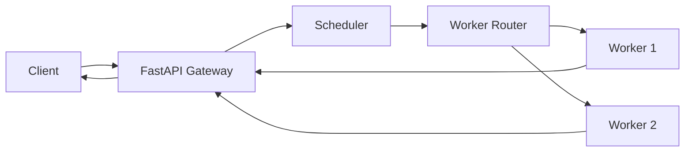

<div align="center">

# Distributed Multi-Model AI Inference Fabric

**A cloud-native platform for serving heterogeneous AI models with Prometheus-backed scheduling and Kubernetes autoscaling.**

<p>
  
  
  
  
  
  
  
</p>

[Overview](#overview) · [Architecture](#architecture) · [Quick Start](#quick-start) · [API](#api-usage) · [Results](#validation-results) · [Limitations](#limitations-and-future-work)

</div>

---

## Overview

Serving different model families (text, vision, generation) through one platform raises real systems questions: how do you route requests, pick a worker, monitor load, and scale replicas?

This project answers them with a single FastAPI gateway in front of a metrics-aware scheduler, a worker router, and independent inference workers, all containerized and orchestrated on Kubernetes.

**Highlights**

- **One API, three workloads:** DistilBERT, YOLOv8n, and TinyLlama behind a single `/infer` endpoint.
- **Prometheus-backed scheduling:** the scheduler reads CPU, memory, latency, and request-rate metrics, and falls back to deterministic round-robin when data is unavailable.
- **Kubernetes autoscaling:** HPA scales workers on CPU utilization using Metrics Server.
- **Built-in observability:** Prometheus scraping and Grafana dashboards for the gateway and both workers.
- **Evidence included:** raw `kubectl` outputs from the final validation run are committed under `evidence/`.

> **Scope:** This is an experimental system validated on a local Docker Desktop Kubernetes cluster. The results show functional integration. They do not establish production-scale performance, and they do not prove the adaptive scheduler outperforms simpler policies. See [Limitations](#limitations-and-future-work).

## Supported Models

| Workload | Model | Task | Runtime |
|---|---|---|---|
| NLP | DistilBERT | Sentiment classification | ONNX Runtime |
| Computer Vision | YOLOv8n | Object detection | ONNX Runtime |
| Language Generation | TinyLlama 1.1B | Text generation | llama.cpp |

## Architecture

<p align="center">
  
</p>
<p align="center"><em>Figure 1. System architecture.</em></p>

### Request flow



1. The client sends a request to the gateway.
2. The scheduler selects a worker using the configured policy and available metrics.
3. The router forwards the request to that worker.
4. The worker runs the model and the result returns through the gateway.

### Two metric paths

| Path | Source | Consumer | Purpose |
|---|---|---|---|
| Application metrics | Gateway and workers, scraped by **Prometheus** | Scheduler, Grafana | Worker selection and dashboards |
| Resource metrics | **Metrics Server** | Kubernetes HPA | CPU-based replica scaling |

Prometheus and Metrics Server are complementary, not interchangeable.

### Components

| Component | Role |
|---|---|
| FastAPI Gateway | Entry point, health and API endpoints |
| Scheduler | Chooses a worker using metrics and the configured policy |
| Worker Router | Forwards requests to the selected worker |
| Inference Workers (×2) | Execute model workloads |
| Prometheus | Scrapes and serves application metrics |
| Grafana | Dashboards |
| Redis | Shared infrastructure service (exact role depends on the active configuration) |
| Metrics Server | Node and pod resource metrics |
| HPA | Scales the primary worker deployment on CPU |

## Scheduling

The scheduler queries Prometheus for per-worker:

- CPU usage
- Memory usage
- Average inference latency
- Request rate

If the required CPU or memory data is unavailable, it falls back to deterministic **round-robin**. A successful scheduler test returned `"metrics_source": "prometheus"`, confirming the Prometheus path was used.

A live metric source does not make a policy optimal. Effectiveness must be measured against baselines (see [Future Work](#future-research-directions)).

## Autoscaling

| Setting | Value |
|---|---:|
| Min replicas | 1 |
| Max replicas | 2 |
| CPU target | 70% |

During testing, the worker deployment scaled from one replica to two and inference requests kept completing.

## Tech Stack

| Category | Technologies |
|---|---|
| Application | Python 3.10, FastAPI, Uvicorn |
| Models | DistilBERT, YOLOv8n, TinyLlama, ONNX Runtime, llama.cpp |
| Monitoring | Prometheus, Grafana, Kubernetes Metrics Server |
| Infrastructure | Docker, Kubernetes, HPA, Redis |
| Evaluation | Python benchmark scripts, CSV artifacts |
| Dev environment | Docker Desktop Kubernetes, PowerShell |

## Repository Structure

```text
Distributed-ai-inference-platform/
├── development_v3/                  # Current implementation
│   ├── main.py                      # FastAPI gateway
│   ├── router.py                    # Worker router
│   ├── scheduler.py                 # Prometheus-backed scheduler
│   ├── models.py                    # Model registry and request schemas
│   ├── worker_api.py                # Inference worker API
│   ├── Dockerfile
│   ├── requirements.txt
│   ├── kubernetes-v3.yaml
│   ├── kubernetes-v3.1.yaml
│   ├── metrics-server-patch.yaml
│   ├── worker-deployment-final.yaml
│   ├── hpa-final-evidence.yaml
│   ├── openapi-live.json
│   ├── Architecture.png
│   └── models/
├── evidence/final-20261027-232859/  # Raw kubectl outputs from final validation
├── main.py, router.py, ...          # Earlier prototype
├── benchmark.py                     # Latency benchmark (prototype)
├── scheduler_experiment.py          # Synthetic scheduler comparison
├── scheduler_independent_eval.py    # Independent scheduler evaluation
├── *.csv, *.png                     # Benchmark results and plots
├── deployment.yaml
└── README.md
```

`development_v3/` is the current implementation. Root-level files preserve the earlier prototype and its experiments.

## Quick Start

### Prerequisites

- Docker Desktop with Kubernetes enabled
- `kubectl` pointed at the intended cluster
- Python 3.10 (for local development and scripts)
- Model artifacts placed where the workers expect them (weights may not be in the repo; check licensing)
- Metrics Server running in the cluster

> **Caution:** Review manifests and image tags before applying anything. Don't apply an older manifest over the working deployment.

### 1. Verify the cluster

```powershell
kubectl config current-context
kubectl get nodes
```

### 2. Check deployments

```powershell
kubectl get deployments,pods,services,hpa
kubectl rollout status deployment/ai-inference-gateway-v3 --timeout=120s
kubectl rollout status deployment/ai-inference-worker-v3 --timeout=120s
kubectl rollout status deployment/ai-inference-worker-v3-2 --timeout=120s
```

### 3. Open the gateway

In a separate terminal (keep it open):

```powershell
kubectl port-forward deployment/ai-inference-gateway-v3 8001:8000
```

Then:

```powershell
Invoke-RestMethod -Uri "http://127.0.0.1:8001/health"
```

Interactive docs: <http://127.0.0.1:8001/docs>

### 4. Optional: monitoring and autoscaling

```powershell
# Resource metrics and HPA
kubectl top pods
kubectl top nodes
kubectl describe hpa ai-inference-worker-v3
kubectl get hpa ai-inference-worker-v3 -w   # watch only; does not generate load

# Prometheus (confirm the deployment name first)
kubectl port-forward deployment/prometheus 9090:9090   # http://127.0.0.1:9090

# Grafana (confirm the deployment name first)
kubectl port-forward deployment/grafana 3000:3000      # http://127.0.0.1:3000
```

The scheduler running inside the cluster needs an in-cluster Prometheus address, not the host-only port-forward URL.

Don't expose Redis publicly without network restrictions and authentication.

## API Usage

All inference goes through `POST /infer`. Check field names against `development_v3/models.py` and `openapi-live.json`.

**Sentiment (DistilBERT)**

```powershell
$body = @{
    model    = "bert"
    priority = 5
    text     = "This platform is working well."
} | ConvertTo-Json -Compress

Invoke-RestMethod -Uri "http://127.0.0.1:8001/infer" -Method Post `
    -ContentType "application/json" -Body $body
```

**Text generation (TinyLlama)**

```powershell
$body = @{
    model    = "llama"
    priority = 5
    text     = "Explain Kubernetes in two simple sentences."
} | ConvertTo-Json -Compress

Invoke-RestMethod -Uri "http://127.0.0.1:8001/infer" -Method Post `
    -ContentType "application/json" -Body $body
```

**Object detection (YOLOv8n)**

Use `model = "yolo"` with a base64-encoded image in the `image_base64` field. See `development_v3/models.py` for the exact request and response format.

## Validation Results

Results from the local development cluster. They are not production performance guarantees.

| Area | Result |
|---|---|
| DistilBERT | Successful inference |
| YOLOv8n | Successful inference; 5 detections on the test image (4 people, 1 bus) |
| TinyLlama | Generation completed; output quality varies with request and runtime |
| Prometheus targets | Gateway, worker 1, and worker 2 all reported up |
| Scheduler | Returned `metrics_source: "prometheus"` |
| Metrics Server | `kubectl top` worked |
| HPA | Scale-up and scale-down observed; final state had 2 ready replicas |
| Gateway health | Healthy, Redis connected, 3 model artifacts registered |

Raw evidence is in [`evidence/final-20261027-232859/`](evidence/final-20261027-232859/).

**Reading the benchmarks:** Sequential latency numbers are not sustained throughput under concurrent load. Synthetic scheduler experiments use proxy costs and should not be read as real-world scheduling performance.

## Limitations and Future Work

### Current limitations

- Local, small-scale cluster (1 to 2 worker replicas)
- Scheduler comparisons so far use synthetic proxy costs
- No sustained concurrent-load throughput measurements
- HPA validates a CPU-based scaling path, not an optimized strategy
- Dashboard and alert coverage depend on the deployed configuration
- No GPU or multi-node results

### Future research directions

1. Compare round-robin, queue-based, resource-aware, and adaptive policies under identical workloads.
2. Measure real worker queues, resource use, and inference latency.
3. Quantify scheduling overhead and its effect on end-to-end latency.
4. Repeat experiments across concurrency levels and workload mixes.
5. Report throughput, p50/p95/p99 latency, error rate, and resource consumption.
6. Study the interaction between scheduling decisions and HPA reaction time.
7. Add validated dashboards and alerting rules.
8. Test other model combinations and hardware.
9. Test worker failure and recovery.
10. Only claim adaptive-scheduling benefits after beating simpler baselines.

## Conclusion

The platform integrates FastAPI, a metrics-aware scheduler, ONNX Runtime, llama.cpp, Docker, Kubernetes, Prometheus, Grafana, Redis, and HPA into one working stack for heterogeneous model serving. The open research question is whether metric-informed worker selection measurably beats simpler policies, which requires controlled experiments, real runtime measurements, and transparent reporting.

## Author

**B. Indira Priyadarshini** · [@BVIPD](https://github.com/BVIPD)

## License

No license has been selected. Unless one is added, standard copyright restrictions apply.
