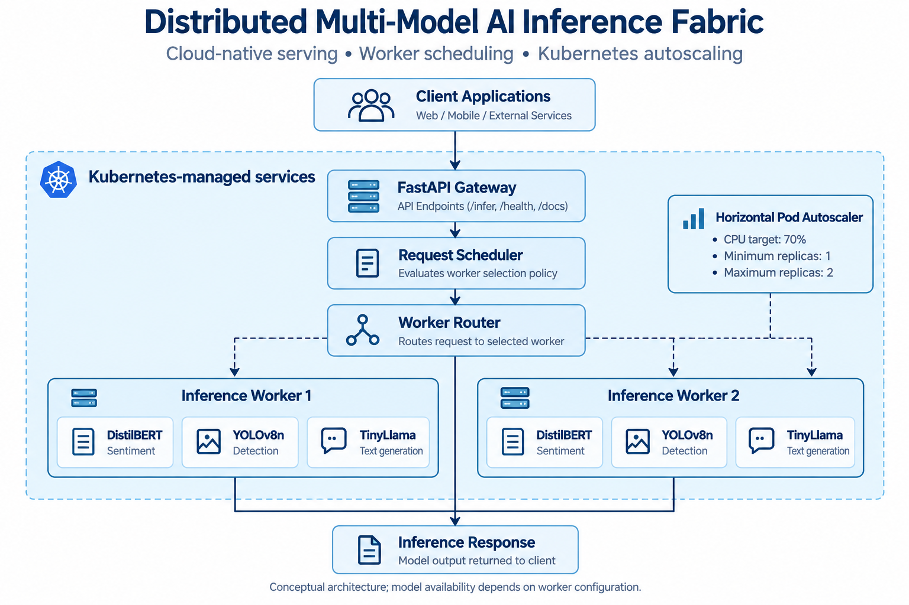
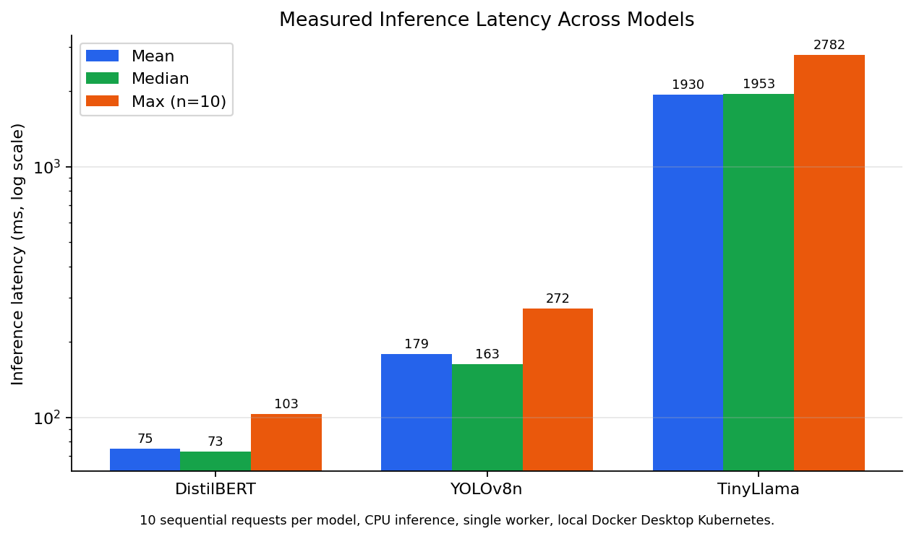
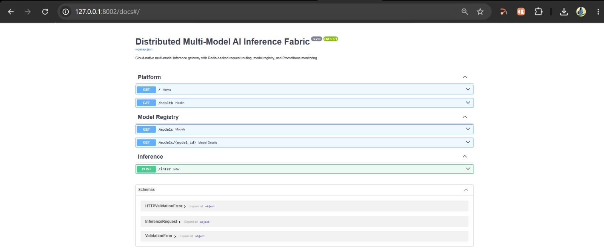
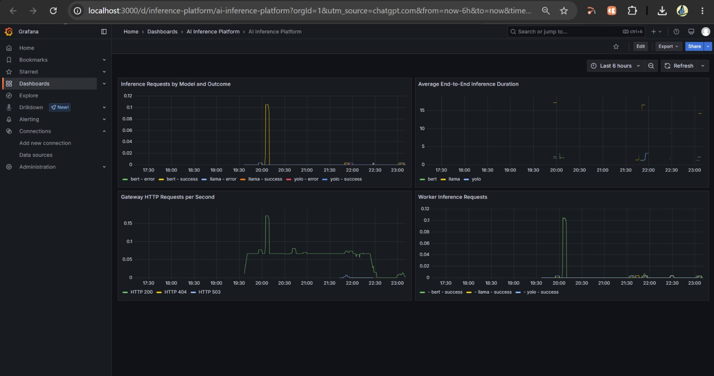
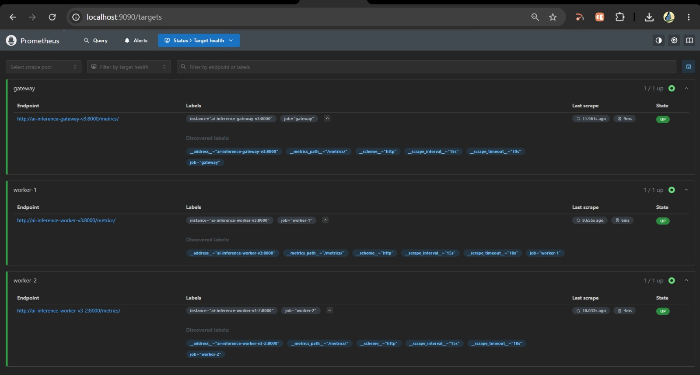
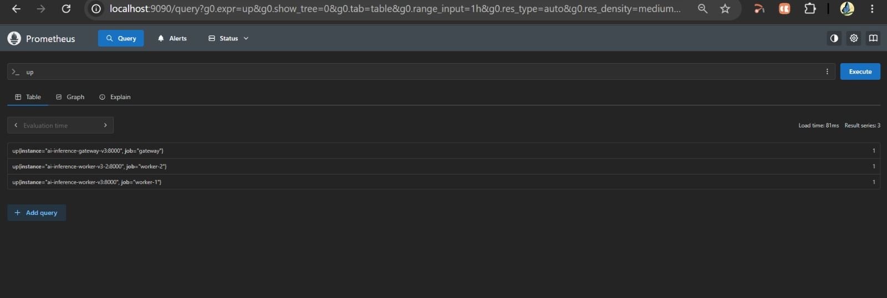
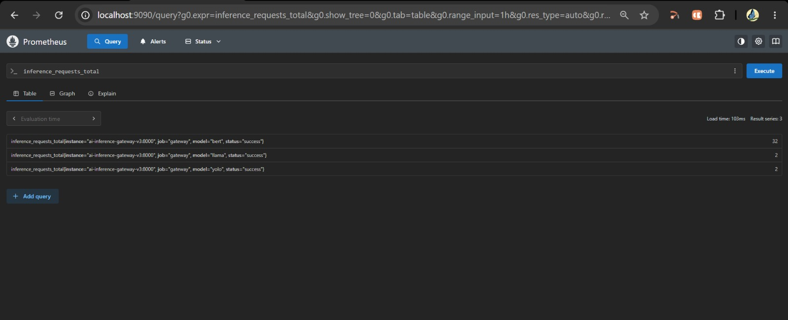
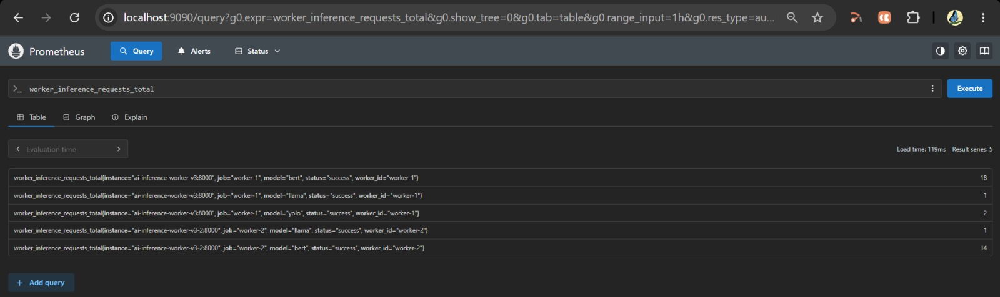
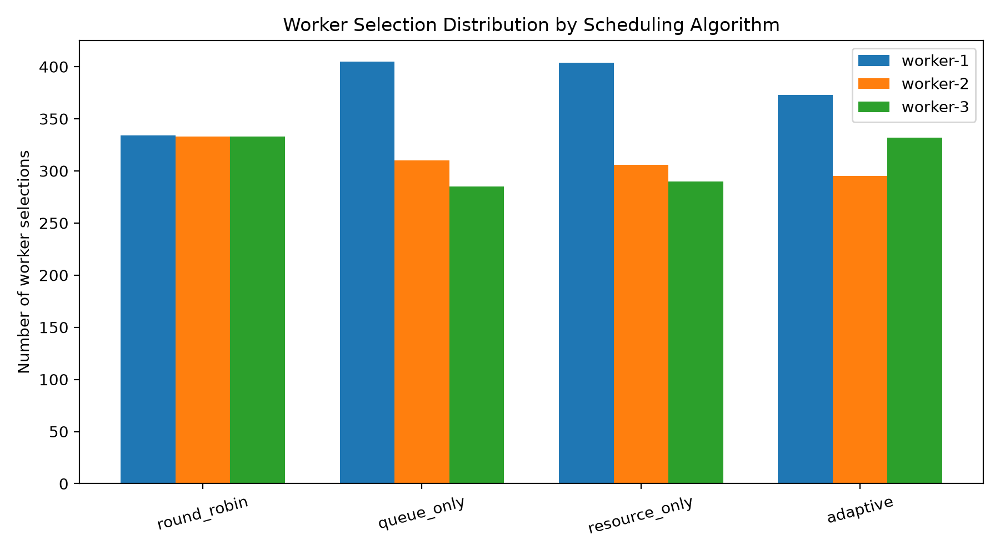

# Distributed Multi-Model AI Inference Platform

A cloud-native platform for serving heterogeneous AI models through a centralized API gateway, adaptive scheduling, distributed inference workers, Kubernetes orchestration, and real-time monitoring.

The project demonstrates how multiple AI workloads can be deployed and monitored within a unified infrastructure, with resource-aware request routing and Kubernetes-based autoscaling.

## Overview

Traditional AI inference systems often deploy different models as separate services, creating challenges in resource utilization, workload distribution, latency management, and scalability.

This project implements a unified inference platform that supports multiple AI workloads through a common API.

The platform integrates:

- A FastAPI inference gateway.
- A model registry and inference router.
- An adaptive scheduler with Prometheus-backed worker metrics.
- Redis for request queuing and result storage.
- Containerized inference workers.
- Kubernetes deployments and Horizontal Pod Autoscaling (HPA).
- Prometheus for metrics collection.
- Grafana for monitoring and visualization.

### Supported AI Models

| Model | Task | Runtime |
|---|---|---|
| DistilBERT | Sentiment classification | ONNX Runtime |
| YOLOv8n | Object detection | ONNX Runtime |
| TinyLlama 1.1B | Text generation | llama.cpp |

The models represent different inference workloads, allowing the platform to demonstrate the challenges of routing and managing heterogeneous AI services.

## Architecture



### Request Processing Flow

1. A client submits an inference request to the FastAPI gateway.
2. The gateway validates the request and identifies the requested model.
3. The scheduling layer evaluates available worker information.
4. The router forwards the request to a suitable inference worker.
5. The selected model performs inference.
6. The response is returned to the client.
7. Prometheus collects application and worker metrics, which can be visualized in Grafana.
8. Kubernetes manages application deployments and can adjust worker replicas through HPA.

Redis provides request queueing and result storage as implemented by the application.

## Key Features

- **Multi-model inference:** Supports sentiment analysis, object detection, and text generation.
- **Centralized API:** Provides a common entry point for inference requests.
- **Adaptive scheduling:** Uses worker metrics and scheduling logic to help select an inference worker.
- **Distributed workers:** Supports multiple worker instances.
- **Containerization:** Packages application components using Docker.
- **Kubernetes orchestration:** Deploys and manages the services.
- **Autoscaling:** Uses Kubernetes HPA to adjust worker replicas according to configured resource targets.
- **Observability:** Exposes application metrics for Prometheus and Grafana.
- **Benchmarking:** Includes scripts and CSV results for latency and scheduler experiments.

## Technology Stack

| Component | Technologies |
|---|---|
| Programming language | Python 3.10 |
| API gateway | FastAPI, Uvicorn |
| Sentiment analysis | DistilBERT, ONNX Runtime |
| Object detection | YOLOv8n, ONNX Runtime |
| Text generation | TinyLlama 1.1B, llama.cpp |
| Scheduling | Python, Prometheus-backed worker metrics |
| Queue and result storage | Redis |
| Containerization | Docker |
| Orchestration | Kubernetes |
| Autoscaling | Kubernetes Horizontal Pod Autoscaler |
| Monitoring | Prometheus, Grafana |
| Evaluation | Python benchmark scripts, CSV results, Matplotlib plots |
| Local environment | Docker Desktop Kubernetes, PowerShell |

## Repository Structure

```text
Distributed-ai-inference-platform/
├── development_v3/
│   ├── main.py
│   ├── router.py
│   ├── scheduler.py
│   ├── models.py
│   ├── model_registry.py
│   ├── worker_api.py
│   ├── Dockerfile
│   ├── requirements.txt
│   ├── kubernetes-v3.yaml
│   ├── kubernetes-v3.1.yaml
│   ├── worker-deployment-final.yaml
│   ├── hpa-final-evidence.yaml
│   ├── metrics-server-patch.yaml
│   ├── redis.yaml
│   ├── prometheus.yaml
│   ├── grafana.yaml
│   ├── openapi-live.json
│   ├── Architecture.png
│   └── models/
│
├── docs/
│   ├── inference_latency.png
│   ├── swagger_api.jpeg
│   ├── grafana_dashboard.jpeg
│   ├── prometheus_targets.jpeg
│   ├── prometheus_up_query.jpeg
│   ├── gateway_inference_requests.jpeg
│   └── worker_inference_requests.jpeg
│
├── evidence/
│   └── final-20261027-232859/
│
├── benchmark.py
├── benchmark_results.csv
├── scheduler_experiment.py
├── scheduler_independent_eval.py
├── scheduler_comparison.csv
├── scheduler_independent_eval.csv
├── deployment.yaml
├── Dockerfile
├── requirements.txt
├── LICENSE
└── README.md
```

The `development_v3/` directory contains the newer inference implementation and Kubernetes-related configuration. Root-level files preserve the earlier prototype and supporting experiments.

The repository also includes benchmark artifacts, monitoring screenshots, deployment evidence, and model-related configuration.

*Note: This tree highlights important files rather than listing every repository file. Verify filenames against the actual repository if you reorganize the project.*

## Prerequisites

Before running the platform, install or configure:

- Docker Desktop.
- Kubernetes enabled in Docker Desktop.
- `kubectl`.
- Python 3.10 for local development and benchmark scripts.
- The model artifacts required by the implementation.
- Kubernetes Metrics Server for resource metrics and CPU-based HPA.
- Sufficient CPU and memory for the selected models.

### Model Files

Model weights are not necessarily included in the Git repository. Obtain compatible model artifacts from their respective model publishers or trusted model repositories, and review their licenses before use.

The model files must match the paths and filenames expected by `development_v3/models.py`.

The intended model assets include:

| Model | Required artifact | Notes |
|---|---|---|
| DistilBERT | Quantized ONNX model and tokenizer/configuration files | Use a compatible sentiment-classification model |
| YOLOv8n | `yolov8n.onnx` | Use a compatible YOLOv8n ONNX export |
| TinyLlama | A compatible TinyLlama GGUF file | Use a quantized GGUF supported by the configured llama.cpp runtime |

A typical model directory may look like this:

```text
development_v3/
└── models/
    ├── distilbert/
    │   ├── model_quantized.onnx
    │   ├── tokenizer.json
    │   └── config.json
    │
    ├── yolo/
    │   └── yolov8n.onnx
    │
    └── tinyllama/
        └── TinyLlama-1.1B-Chat-v1.0-Q2_K.gguf
```

**Important:** Treat this as an illustrative layout. Confirm the exact filenames, directories, tokenizer requirements, and model identifiers against the current `development_v3/models.py` and the actual worker configuration before downloading or moving files.

Do not commit large model weights or model files whose redistribution terms do not permit it.

## Quick Start

The following instructions describe how to inspect and access an existing local Kubernetes deployment. They do not require deleting or recreating the current cluster.

### 1. Start Docker Desktop

Start Docker Desktop and ensure that its Kubernetes cluster is running.

Open PowerShell in the repository directory.

Verify the active Kubernetes context:

```powershell
kubectl config current-context
kubectl get nodes
```

For the tested local environment, the context was `docker-desktop`.

### 2. Check the Deployment

Inspect the current deployments, pods, services, and autoscaler:

```powershell
kubectl get deployments,pods,services,hpa
```

Check the gateway and worker deployments:

```powershell
kubectl rollout status deployment/ai-inference-gateway-v3 --timeout=120s
kubectl rollout status deployment/ai-inference-worker-v3 --timeout=120s
kubectl rollout status deployment/ai-inference-worker-v3-2 --timeout=120s
```

These commands inspect rollout status. If a deployment name differs in your environment, obtain the actual name from `kubectl get deployments`.

**Caution:** Review Kubernetes manifests and image tags before applying them. Do not apply an older manifest over a working deployment without first reviewing the changes.

### 3. Access the API Gateway

Open a separate PowerShell terminal and run:

```powershell
kubectl port-forward deployment/ai-inference-gateway-v3 8001:8000
```

Keep this terminal open while using the gateway.

Open the interactive API documentation:

```text
http://127.0.0.1:8001/docs
```

Check the health endpoint from another terminal:

```powershell
Invoke-RestMethod -Uri "http://127.0.0.1:8001/health"
```

The health response from the validated environment reported an operational gateway, Redis connectivity, and three registered models with available artifacts.

### 4. Access Prometheus

In another PowerShell terminal, forward the Prometheus service or deployment using its actual name:

```powershell
kubectl get services
kubectl get deployments
```

For the validated deployment, the following command was used:

```powershell
kubectl port-forward deployment/prometheus 9090:9090
```

Open:

```text
http://localhost:9090
```

To inspect scrape target health, open:

```text
http://localhost:9090/targets
```

To check whether targets are reporting as available, enter this PromQL query:

```promql
up
```

The recorded validation showed the gateway, worker-1, and worker-2 targets reporting `1`.

### 5. Access Grafana

Use the configured Grafana port-forward or service to open the Grafana interface.

The validated dashboard was titled **AI Inference Platform** and included panels for:

- Inference requests by model and outcome.
- Average end-to-end inference duration.
- Gateway HTTP requests per second.
- Worker inference requests.

The dashboard depends on Prometheus being configured as a data source and collecting the relevant application metrics.

### 6. Inspect Resource Usage and Autoscaling

Check pod resource metrics:

```powershell
kubectl top pods
kubectl top nodes
```

Inspect the worker autoscaler:

```powershell
kubectl get hpa
kubectl describe hpa ai-inference-worker-v3
```

To watch autoscaler status:

```powershell
kubectl get hpa ai-inference-worker-v3 -w
```

The watch command displays changes but does not generate inference load by itself.

The tested HPA configuration used a CPU utilization target of 70%, with a minimum of one replica and a maximum of two replicas. Actual scaling depends on the current workload, resource requests, metrics availability, and configured HPA behavior.

## API Usage

The platform exposes a FastAPI interface with endpoints for platform health, model discovery, model details, and inference.

The interactive Swagger interface is available at:

```text
http://127.0.0.1:8001/docs
```

### Main Endpoints

| Method | Endpoint | Purpose |
|---|---|---|
| GET | `/` | Platform information |
| GET | `/health` | Health check |
| GET | `/models` | List registered models |
| GET | `/models/{model_id}` | Retrieve model details |
| POST | `/infer` | Submit an inference request |

The exact request schema and available parameters should be inspected in the live Swagger documentation because they depend on the current API implementation.

### Example Workflow

1. Open `/docs`.
2. Expand `GET /health` and execute the health check.
3. Expand `GET /models` and inspect the registered models.
4. Open `POST /infer`.
5. Select the request schema and enter a valid payload for the desired model.
6. Execute the request and inspect the returned inference result and execution metadata.

For YOLO inference, provide the image data in the format required by the current request schema. For DistilBERT and TinyLlama, use the corresponding text-input format defined by the API.

Do not assume that all models accept the same input fields.

## Scheduling and Worker Selection

The scheduling layer is responsible for selecting an inference worker for incoming requests.

The current implementation can query Prometheus for worker metrics, including CPU utilization, memory usage, inference latency, and request rate, where the required metrics are available.

These metrics help the scheduler estimate the relative state of available workers.

### Scheduling Workflow

1. Receive the incoming inference request.
2. Identify the requested model and validate the scheduling parameters.
3. Retrieve the available worker information.
4. Query Prometheus for supported worker metrics.
5. Calculate the worker scores using the configured scheduling logic.
6. Select a worker and forward the request.
7. Return the inference response and available scheduling metadata.

The implementation also includes a fallback path when the required live metrics are unavailable. In the tested configuration, the fallback was identified by:

```text
metrics_source: round_robin_fallback
```

When the scheduler successfully used the Prometheus-backed metrics path, the response reported:

```text
metrics_source: prometheus
```

These values describe the metrics source used for a scheduling decision; they do not independently prove that one scheduling policy outperforms another.

### Scheduler Evaluation

The repository contains scheduler experiment and evaluation scripts for comparing policies such as:

- Round robin.
- Queue-only scheduling.
- Resource-only scheduling.
- Adaptive scheduling.

The synthetic evaluation results are reported separately from measured model inference benchmarks because they use simulated scenarios and proxy costs rather than actual model execution latency.

## Redis: Request Queue and Result Store

Redis provides request queueing and result storage in the application configuration.

In the implementation described by the deployment and application configuration, requests are represented as queue jobs and results are associated with request identifiers.

The configured Redis setup uses an ephemeral storage model rather than durable job storage. The configuration described for this deployment includes a 64 MB memory limit, an `allkeys-lru` eviction policy, and disabled append-only persistence.

These settings have important operational implications:

- Redis memory is limited.
- Keys can be evicted under memory pressure.
- Queued jobs and results should not be treated as permanently stored.
- Redis restarts may interrupt or lose in-memory work.
- Redis should not be considered a durable message broker or database without additional persistence and recovery mechanisms.

Review the current Redis manifest and application code before relying on exact queue names, result-key formats, or expiration times, as these details can change between implementations.

## Validation Results

The following measurements and checks were collected from the local Docker Desktop Kubernetes environment. They demonstrate local functionality and are not production performance guarantees.

### Measured Inference Latency



*Benchmark conditions: 10 sequential requests per model, CPU inference, a single worker, and local Docker Desktop Kubernetes.*

| Model | Mean latency (ms) | Median latency (ms) | Maximum latency (ms) |
|---|---:|---:|---:|
| DistilBERT | 74.77 | 73.21 | 102.89 |
| YOLOv8n | 178.75 | 162.95 | 272.01 |
| TinyLlama 1.1B | 1930.22 | 1953.18 | 2781.89 |

These measurements show that latency differs substantially across the three workloads. TinyLlama has a higher inference latency than DistilBERT and YOLOv8n in this local CPU-based test.

The maximum is reported rather than p95 because the benchmark contains only ten observations per model. With such a small sample, a percentile estimate is not a robust characterization of tail latency.

The results should not be interpreted as concurrent-load performance, throughput capacity, or a comparison with GPU inference.

Raw benchmark data is available in:

```text
benchmark_v3_repeated_results.csv
```

Confirm the location of this file in the current repository before using the path in scripts or external reports.

### Functional Validation

| Validation area | Recorded result |
|---|---|
| API gateway | Health endpoint responded successfully |
| Model registry | Three registered models and available artifacts were reported |
| DistilBERT inference | Sentiment inference completed successfully |
| YOLOv8n inference | Object detection completed successfully; five detections were returned for the tested 810 +� 1080 image |
| TinyLlama inference | Text-generation request completed successfully |
| Prometheus targets | Gateway, worker-1, and worker-2 targets reported `UP` |
| Scheduler metrics | Prometheus metrics source was reported in tested inference responses |
| Worker distribution | Requests were observed across two workers |
| Kubernetes autoscaling | A second worker replica became ready during a recorded high-CPU test |
| Pod stability | The final recorded inspection reported zero restarts for the inspected pods |

These results describe the recorded local validation runs. They do not guarantee that the same replica count, resource usage, latency, or pod status will be observed on every restart or workload.

### Monitoring Evidence

The following screenshots document the API and observability checks.

#### 1. Swagger API Documentation



The Swagger interface displays the platform endpoints for health checks, model discovery, and inference.

#### 2. Grafana Dashboard



The dashboard visualizes inference requests, end-to-end duration, gateway HTTP activity, and worker inference requests.

#### 3. Prometheus Scrape Targets



The targets page shows the configured gateway and worker endpoints and their scrape status during the recorded check.

#### 4. Prometheus Target Availability Query



The `up` query returned successful target values for the gateway and both workers in the captured validation.

#### 5. Gateway Inference Requests



The Prometheus query shows gateway inference request counters by model and outcome for the captured state.

#### 6. Worker Inference Requests



The worker metrics show inference request counters associated with the two worker instances and their model labels.

#### 7. Worker Distribution Plot



The worker distribution plot is included as a repository artifact. Interpret it using the experiment and CSV data that produced it; the plot alone does not establish general scheduling superiority.

## Synthetic Scheduler Experiments

The repository includes synthetic scheduler evaluations that compare different worker-selection policies using simulated scenarios and proxy costs.

One recorded experiment used seed 42 and 1,000 synthetic scenarios.

| Scheduling policy | Mean proxy cost |
|---|---:|
| Round robin | 2.678 |
| Queue-only | 2.131 |
| Resource-only | 2.457 |
| Adaptive | 2.259 |

In this experiment, **queue-only scheduling achieved the lowest mean proxy cost**, followed by adaptive scheduling.

This result is important: the experiment does not establish that the adaptive policy is universally superior. It shows that the relative performance depends on the workload, metric definitions, policy configuration, and evaluation methodology.

The proxy costs are not measured inference latencies. They should not be compared directly with the measured model latency table.

Local scheduler decision overhead was reported in the range of approximately 0.0005G��0.0027 ms per decision for the evaluated setup, excluding HTTP communication and model inference. This is an experiment-specific result, not a general performance guarantee.

See the scheduler experiment and evaluation scripts and their corresponding CSV artifacts for the methodology and results.

## Limitations

The current project is a local cloud-native prototype and has several limitations.

- **Hardware:** The reported inference benchmark uses CPU inference in a local environment.
- **Sample size:** The repeated latency benchmark contains ten sequential requests per model.
- **Concurrency:** The latency benchmark does not establish performance under concurrent or sustained high-volume traffic.
- **Scheduler evaluation:** Synthetic proxy-cost experiments do not prove that adaptive scheduling outperforms all baseline policies under real workloads.
- **Autoscaling:** The tested HPA configuration has a maximum of two replicas and is not a large-scale capacity evaluation.
- **Redis durability:** The configured in-memory Redis setup should not be treated as durable job storage.
- **Production readiness:** Authentication, authorization, TLS, durable job recovery, comprehensive failure handling, and production deployment hardening require separate assessment.
- **Generalization:** Results from Docker Desktop Kubernetes may differ from results on a multi-node production cluster.

## Future Enhancements

Potential next steps include:

- Evaluate scheduler policies under controlled concurrent workloads.
- Increase benchmark repetitions and report robust latency percentiles.
- Measure throughput, queue waiting time, CPU utilization, memory usage, and end-to-end latency together.
- Compare adaptive scheduling with FCFS, priority-based, queue-only, and resource-only baselines.
- Improve scheduler behavior when metrics are missing or stale.
- Evaluate scaling behavior with more worker replicas.
- Add automated benchmark collection and reproducible result generation.
- Strengthen Redis recovery and request-failure handling.
- Add authentication, secure configuration management, and deployment hardening.
- Evaluate the platform on a multi-node Kubernetes cluster.

## Reproducibility

The repository contains the application code, deployment configuration, experiment scripts, benchmark data, and supporting evidence needed to inspect the implementation.

For reproducible experiments:

1. Record the code revision and deployment configuration.
2. Record model artifacts and versions.
3. Document CPU, memory, and Kubernetes resource limits.
4. Specify request payloads, warm-up behavior, and repetition counts.
5. Preserve raw measurements and experiment parameters.
6. Distinguish measured inference results from synthetic scheduler simulations.
7. Record the Prometheus metrics and scheduling policy configuration used for each run.

Model artifacts and third-party dependencies remain subject to their respective licenses.

## License

This project is released under the [MIT License](LICENSE).

Copyright (c) 2026 Bhuvanagiri Indira Priyadarshini.

The MIT License applies to this project's code and associated materials covered by the license. Third-party dependencies and model weights retain their respective licenses and terms.
